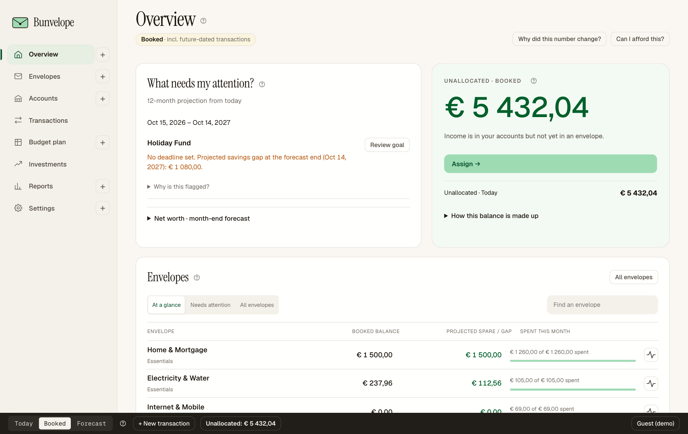
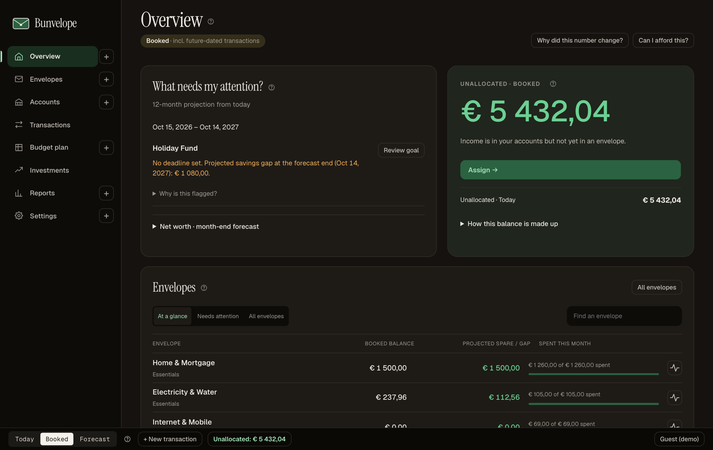
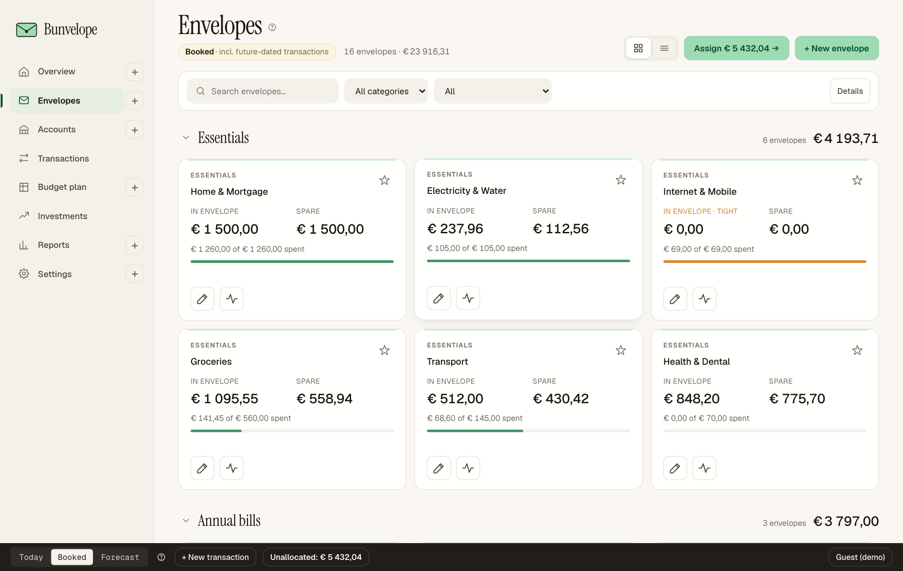
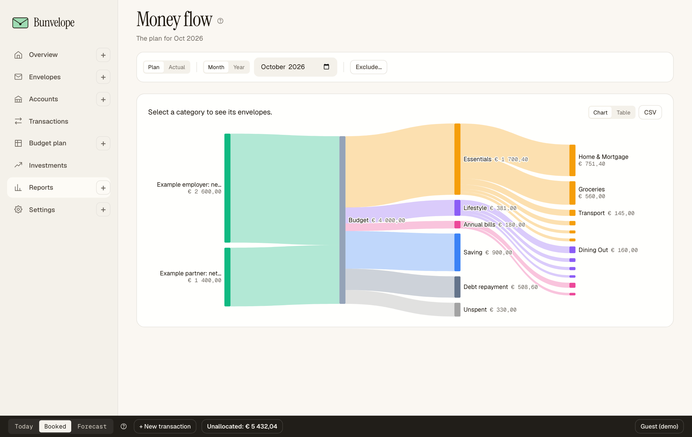
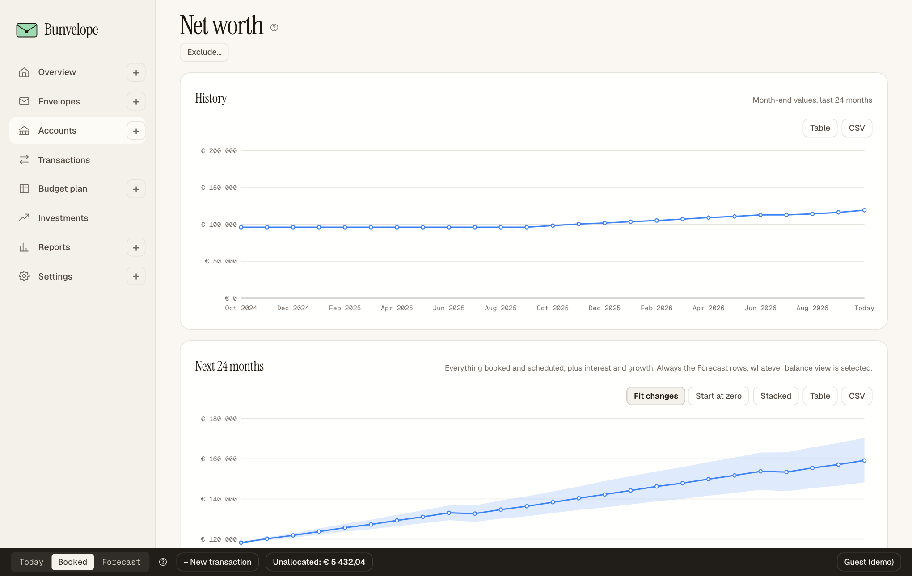

# Bunvelope

Envelope budgeting that looks ahead. Give every euro a job, then see what your
plan does to your accounts and envelopes over the next months: shortfalls,
reserve gaps and savings goals show up before they happen.

<p align="center">
  
  
</p>

- **Your data, your disk.** Local mode keeps the budget as plain JSON files in a
  folder you choose. No account, no server, nothing leaves the machine.
- **Or self-hosted.** Cloud mode is a small Express + Postgres server you run
  yourself, with Google sign-in or a shared password.
- **No build step, no framework.** Vanilla JavaScript modules, served as-is.
- **A tested money engine.** Pure functions with no hidden clock, type-checked
  with `tsc --checkJs`, and a large Vitest suite that also runs across
  timezones.
- **Same commands everywhere.** The web app, a headless CLI and the optional AI
  assistant all go through one command/query layer.

### Try it in a minute

```bash
git clone https://github.com/KalastajaM/bunvelope.git
cd bunvelope
./serve.sh
```

Open **http://localhost:8080** in Chrome or Edge, choose **Continue as guest**
and **Load example budget**. The demo lives in memory only and is gone on
reload.

### How it works

A vanilla-JS envelope budgeting app. It runs in two modes:

- **Local mode** — open a folder on disk via the File System Access API. No server, no account, your data never leaves the machine.
- **Cloud mode** — Express + Postgres backend with Google OAuth (or a shared-password bypass), encrypted blob backups, and an optional AI assistant.

Both offer **Continue as guest** on the welcome screen: a demo budget held in memory only, gone on reload.

The frontend has no build step — the same `js/` and `css/` files are served as-is in both modes. The cloud server adds API endpoints and serves the static assets.

<p align="center">
  
  
  
</p>

## Optional desktop application

The Electron module packages the local-folder app for macOS and Windows. It has
its own dependencies, installers and opt-in update configuration; cloud and
browser-local use do not depend on it. See [desktop setup and release guide](desktop/README.md).

## Features

- **Overview** — balances, unallocated status, interactive charts, and a date-ordered attention list for projected cash shortfalls, envelope reserve gaps and savings goals.
- **Number changes** — choose a date in Overview to explain changes in net worth, projected net worth, envelope spare and unrealized gains. Financial history is saved automatically; unavailable dates are clearly labelled.
- **Envelope funding help** — preview transfers from spare envelopes to reduce forecast gaps, with reserve and savings-goal checks before applying.
- **Purchase check** — preview a purchase's effect on envelope spare, daily cash shortfalls and savings goals; try funding moves, then explicitly record or schedule the purchase.
- **Envelopes** — create, edit, and categorize envelopes; reusable templates for fills and allocation rules.
- **Accounts** — track multiple accounts and their balances, with reconciliation; **Net worth** adds a 24-month simulation and what-if scenarios.
- **Forecast checks**: Net worth shows actionable items under Things to check, with a direct correction action. View all accounts and How this forecast is calculated keep dates, balance-check evidence and assumptions available on demand, without claiming bank coverage or a complete plan. The full evidence is also available through `forecast readiness` in the CLI.
- **Transactions** — add, edit, filter, search, bulk operations.
- **Import** — bank CSV import from the Transactions page; with AI enabled, a PDF statement or photo can be read too.
- **Import rules**: preview remembered merchant naming and envelope suggestions in CSV and AI file reviews. Conflicting rules require a choice. Use Remember correction or Manage rules; saving a rule keeps it even if the import is cancelled. Rules never change amounts, dates or accounts.
- **Budget plan** — regular-expense line items (`budget-items.json`), with a **Monthly review** and **Stress** scenarios.
- **Scheduled transactions** — recurring transactions that post on their due date.
- **Investments** — holdings, gains and allocation charts.
- **Reports** — spending breakdowns and charts.
- **Headless CLI** — query balances, reports and projections; record and import transactions; manage budgets through core commands, with dry runs and atomic batches.
- **Clean-up** (Settings) — data problems, likely duplicate transactions and payee tidy-up, before you go looking.
- **Getting started** — a setup wizard, a first-steps checklist, starter envelopes and a simple mode that hides the advanced pages.
- **AI assistant** — optional Anthropic-powered helper (cloud mode): ask questions, insights, import reading and suggestions. Each user supplies their own Anthropic API key in Settings → AI.
- **Price lookups** — `/api/prices` proxy for currency/asset values (cloud mode).

## Local mode (no server)

```bash
./serve.sh
```

Then open **http://localhost:8080** in Chrome or Edge.

`serve.sh` runs `node scripts/static-server.mjs 8080` (also `npm run dev:static`), a static server that tells the browser not to cache, so a pull or branch switch never leaves the page running a mix of old and new modules. Any static file server works, but one that lets the browser cache the modules (`python3 -m http.server`, `npx http-server`) can need a hard reload after an update:

```bash
node scripts/static-server.mjs 8080
python3 -m http.server 8080
npx serve
```

> The File System Access API requires Chrome or Edge. Safari is not supported.

### First load (local)

1. Click **Open Budget Folder** on the welcome screen.
2. Select the folder that will hold your budget data.
3. Grant read/write access when prompted.

The app reads and writes these JSON files inside that folder:

| File | Contents |
|------|----------|
| `envelopes.json` | Envelope definitions and balances |
| `budget-items.json` | Regular-expense line items (budget plan) |
| `transactions.json` | All transactions, including scheduled ones (`status: 'scheduled'`) |
| `accounts.json` | Account balances |
| `envelope-templates.json` | Reusable allocation rules |
| `budget-meta.json` | App metadata (currency, start date, etc.) |
| `.bunvelope-publish.json` | Write journal, so an interrupted multi-file save can be finished on the next open |

## Cloud mode (Express + Postgres)

The server lives in `server/` (entry: `server/index.js`). It serves the same frontend, exposes `/api/*` for budget data, `/auth/*` for Google OAuth, and `/api/ai/*` for the assistant. CSP and session cookies are set up via Helmet + `express-session` with `connect-pg-simple`.

Cloud mode runs locally: there is no hosted deployment. The full setup (Postgres via Homebrew or Docker, `.env`, migrations, logs, self-hosting) is in [docs/running-locally.md](docs/running-locally.md).

### Headless CLI

Use the same commands and queries as the web app without starting Express.
The CLI runs on Node.js 20+ from this checkout (`npm install` first), against
Postgres or a local JSON bundle. See the [CLI usage guide](docs/cli.md) for
setup, all command families, bulk imports, atomic batches, policies and the
protocol used by scripts.
For another project's integration, start with
[calling from another project](docs/cli.md#calling-from-another-project),
including checkout pinning, schema discovery and process/JSON handling.

```bash
npm run cli -- help
npm run cli -- help transaction record

# Postgres: DATABASE_URL comes from the environment or .env.
# Replace these example values with the owner and budget UUID from budgets list.
node bin/bunvelope.mjs budgets list --user owner@example.com
node bin/bunvelope.mjs balances --budget BUDGET_UUID --user owner@example.com --lens booked
node bin/bunvelope.mjs review month --budget BUDGET_UUID --user owner@example.com --month 2026-10

# A local bundle needs no database; preview a write before committing it.
node bin/bunvelope.mjs transaction record --file budget.json --type expense --amount 12.30 --account Checking --envelope Groceries --dry-run

# Repeat a calculation with an explicit clock and timezone.
TZ=Europe/Helsinki node bin/bunvelope.mjs balances --file budget.json --lens today --now 2026-10-01
```

Use `node bin/bunvelope.mjs` (or `npm run --silent cli --`) when piping JSON;
plain `npm run cli --` also prints npm's script banner. Core verbs take exactly
one of `--budget BUDGET_UUID` or `--file budget.json`; protocol commands such as
`budget read` use `--id BUDGET_UUID`. The CLI is a trusted administration
interface with database-level access; `--user` scopes database operations to
one owner's budgets. Encrypted budgets cannot be read or edited headlessly.

### Quick start

```bash
cp .env.example .env           # fill in SESSION_SECRET and a login method
docker compose up -d postgres  # or Homebrew postgresql@16 via `npm run dev:local`
npm install
npm run migrate                # apply server/migrations/*.sql
npm run dev:server             # node --watch server/index.js
```

Open **http://localhost:3000**.

`npm run dev:static` is also available if you want to run the frontend on `:8080` against FSAPI without the server.

### Configuration

See `.env.example` for the full list. Key variables:

| Var | Purpose |
|-----|---------|
| `DATABASE_URL` | Postgres connection string |
| `SESSION_SECRET` | 64+ random bytes; rotates all sessions |
| `GOOGLE_CLIENT_ID` / `GOOGLE_CLIENT_SECRET` | Google OAuth client |
| `OAUTH_CALLBACK_URL` | Must match the redirect URI on the OAuth client |
| `BYPASS_GOOGLE` / `BYPASS_PASSWORD` | Disable Google and gate access with a shared password instead |
| `BUNVELOPE_SECRETS_KEY` | Encrypts each user's Anthropic API key at rest (AES-256-GCM). There is no server-wide AI key: each user enters their own in Settings → AI; the models are fixed in `js/ai/intents.js` |
| `ALLOWED_EMAILS` | Comma-separated Google sign-in allowlist; unset lets any Google account sign up |
| `MAX_BUDGETS_PER_USER` | Per-user budget cap, default 50 |
| `PGSSL` | Usually unset: a local database gets no TLS, any other host gets TLS with certificate verification. `disable` / `verify` / `no-verify` override, and an explicit `sslmode=` in the URL wins over everything |
| `TRUST_PROXY` | Only behind a TLS-terminating reverse proxy (usually `1`) |
| `BACKUP_DIR` / `BACKUP_KEEP` | Where `npm run backup` writes (default `~/Bunvelope-backups`) and how many files it keeps per budget (default 30) |

### Backups

`npm run backup` writes every budget to a timestamped JSON file outside the database. Run it daily; see [docs/backups.md](docs/backups.md) for the launchd schedule and how to restore.

## Accounting invariant

```
sum(account balances) = sum(envelope balances) + unallocated
```

"Unallocated" is always derived and shown in the bottom status bar.

## Appearance

The **Tweaks** panel (rail, or the button in the top nav) switches navigation style (`data-nav` on `#app-root`: rail/top/hybrid), density (`data-density`: compact/comfy/spacious), accent (`data-accent`) and simple/full mode (`data-ui-mode`); these sync to the account. Theme is Light / Dark / System (`data-theme` on `<html>`), stored per browser and following the OS by default.

## Development

```bash
npm install            # dev dependencies (vitest, eslint, typescript, playwright, jsdom)
npm run lint           # eslint
npm run typecheck      # tsc --checkJs over js/engine/** and js/utils.js
npm test               # the Vitest suite
npm run test:watch     # tests in watch mode
npm run test:tz        # the suite in four timezones
npm run test:coverage  # engine coverage against the vitest.config.js thresholds
npm run test:e2e       # Playwright; `--project=static` needs no database
```

Lint, typecheck and test are the per-change gate; see [CONTRIBUTING.md](CONTRIBUTING.md) for when the others apply.

The frontend has no build step — source files in `js/` and `css/` are served as-is in both modes.

## Status and contributing

Bunvelope is a personal project, built and used daily for one household's
budget, and shared as-is. Issues and pull requests are welcome; see
[CONTRIBUTING.md](CONTRIBUTING.md). Most of the code was written with AI
coding assistants (Claude Code and Codex) working under the project's own
rules: lint rules that keep money math out of the pages, a clock-free engine,
and a test gate on every change.

## License

[MIT](LICENSE). Bundled fonts (Geist, Geist Mono, Instrument Serif) are under
the SIL Open Font License; see `fonts/`.
